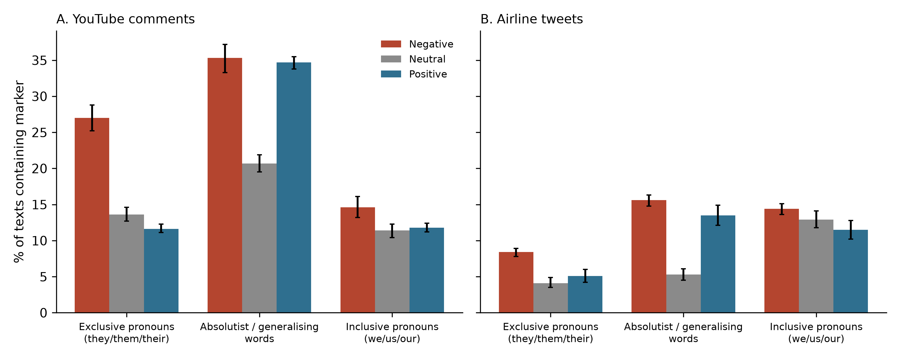

# NLP-Driven Linguistic Biomarker Discovery

*Applied sociolinguistic AI · Natural language processing · Statistical machine learning · Reproducible research*

Code for the empirical study in *Applied Sociolinguistic AI for Community Development (ASA-CD): a framework for linguistically grounded community intervention, with evidence from two public corpora* (Alam & Ferzana).

## Overview

This repository contains the reproducible analysis code and archived results for an empirical investigation of **linguistic markers associated with sentiment** across two public social media corpora. It quantifies exclusive pronouns, inclusive pronouns and absolutist language, then evaluates their relationships with sentiment using statistical tests, logistic and ordinal regression, topic controls and robustness checks.

**Technology:** Python, pandas, NumPy, SciPy, statsmodels, scikit-learn and Matplotlib.

### Results visualisation



A [scalable vector version](results/figure_biomarkers.svg) is also available. The error bars indicate 95% bootstrap confidence intervals.

### Repository structure

```text
├── biomarkers.py                   # Linguistic feature extraction and primary analysis
├── robustness.py                    # Additional model specifications and robustness checks
├── referent_coding_sheet.csv        # Sample for referent coding
├── requirements.txt                 # Python dependencies
├── data/                            # Download the two source datasets here
└── results/
    ├── results.json                # Main findings
    ├── robustness.json             # Robustness analyses
    ├── figure_biomarkers.png       # Generated figure
    └── figure_biomarkers.svg       # Vector rendition
```

## Data
Download both public datasets into `data/`:
- Corpus A – YouTube comments dataset: https://www.kaggle.com/datasets/atifaliak/youtube-comments-dataset (file `YoutubeCommentsDataSet.csv`, columns `Comment`, `Sentiment`)
- Corpus B – Twitter US Airline Sentiment: https://www.kaggle.com/datasets/crowdflower/twitter-airline-sentiment (file `Tweets.csv`; keep columns `text`, `airline_sentiment` and rename the latter to `sentiment`, or edit the column names in the scripts)

## Run
```
pip install -r requirements.txt
python biomarkers.py data/YoutubeCommentsDataSet.csv data/Tweets.csv results/
python robustness.py data/YoutubeCommentsDataSet.csv data/Tweets.csv results/
```
`biomarkers.py` produces prevalence tables, chi-square / Kruskal–Wallis tests, the main logistic regression (`results/results.json`) and Figure 1. `robustness.py` runs checks R1–R6 (`results/robustness.json`) and writes `referent_coding_sheet.csv`.

## Referent coding
`referent_coding_sheet.csv` contains 200 randomly sampled texts (100 per corpus) that contain *they/them/their*. The column `referent_coder1` gives the referent of the first exclusive pronoun, coded with AI assistance and reviewed by the first author, using these categories:

| Code | Meaning |
|---|---|
| `other_people_group` | people or social groups (e.g. kids, teachers, parents) |
| `institution_company_staff` | organisations, companies, governments, or their staff |
| `specific_individuals` | named or identifiable individuals (e.g. two presenters, a politician) |
| `object_non_human` | products, animals, games, bags, documents |
| `generic_impersonal` | generic or impersonal uses ("they say", "someone ... their") |
| `unclear` | referent cannot be determined |

`referent_coder2` is left blank for an independent second coder; agreement can then be reported as Cohen's kappa.

## Word lists
- Exclusive pronouns: they, them, their, theirs, themselves
- Inclusive pronouns: we, us, our, ours, ourselves
- Absolutist words (Al-Mosaiwi & Johnstone, 2018): absolutely, all, always, complete, completely, constant, constantly, definitely, entire, ever, every, everyone, everything, full, must, never, nothing, totally, whole

## Research scope and limitations

The analysis identifies **associations, not causal effects**. Linguistic features are defined by transparent dictionaries and may depend on context, language variety and corpus characteristics. The original full corpora are not redistributed here; follow the dataset links and their licensing terms. Saved results and the coding sheet are provided to aid inspection and reproducibility.

## Licence
MIT. The datasets are subject to their own licences on Kaggle.
